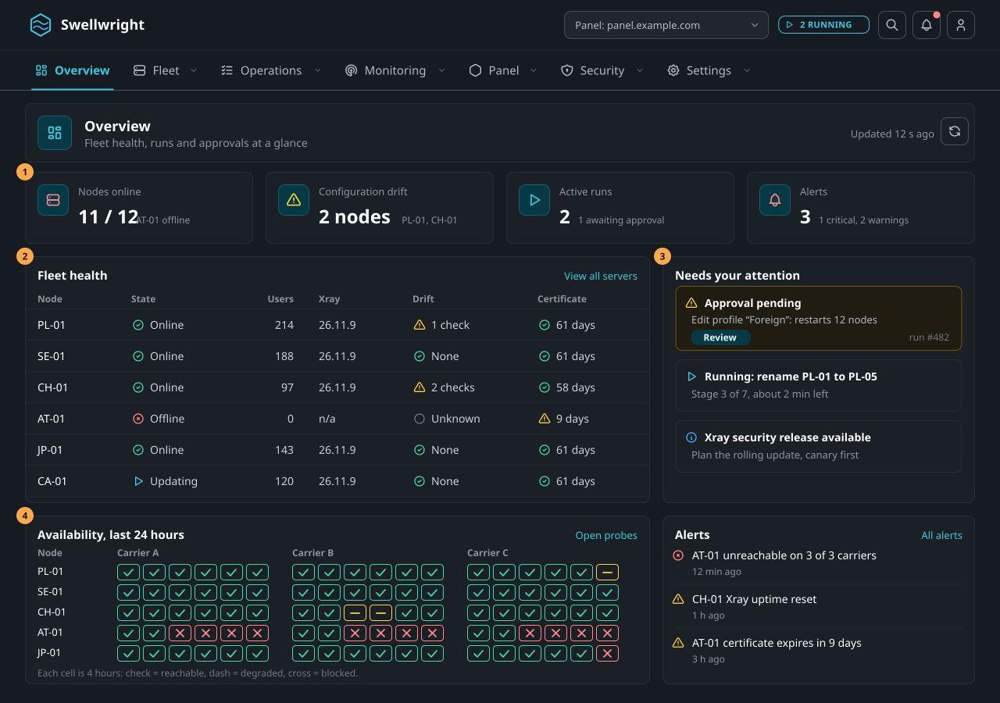
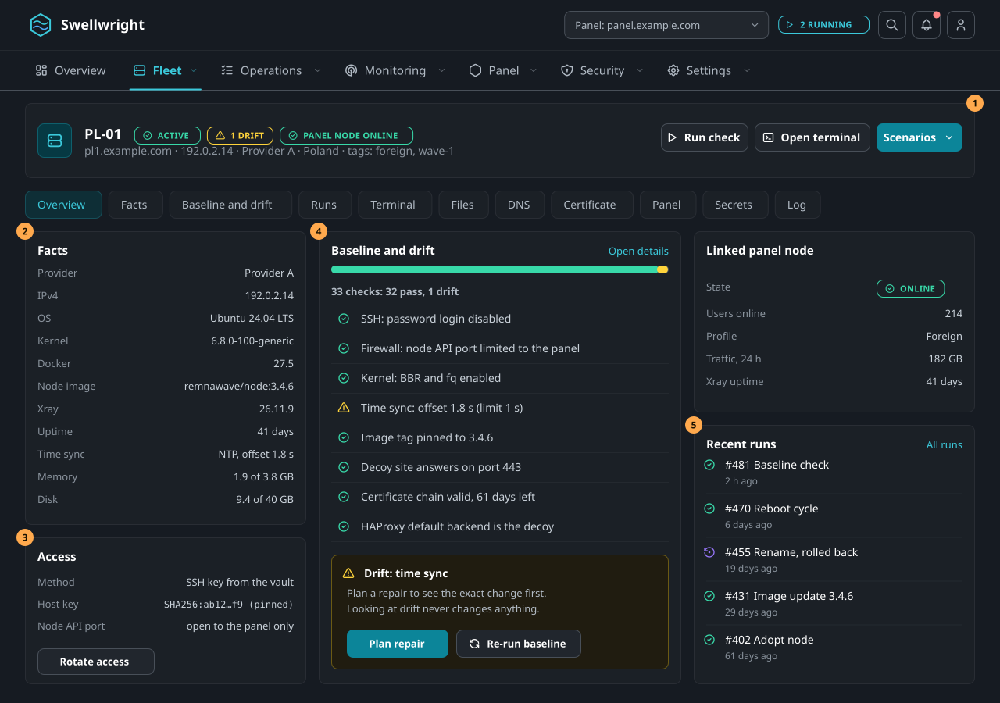
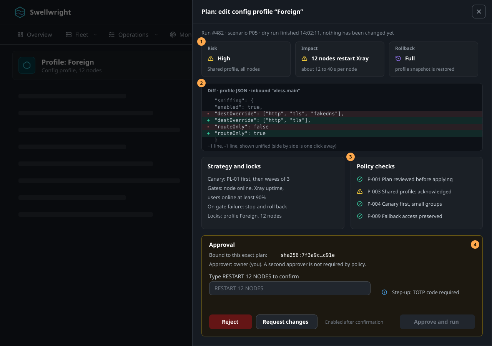
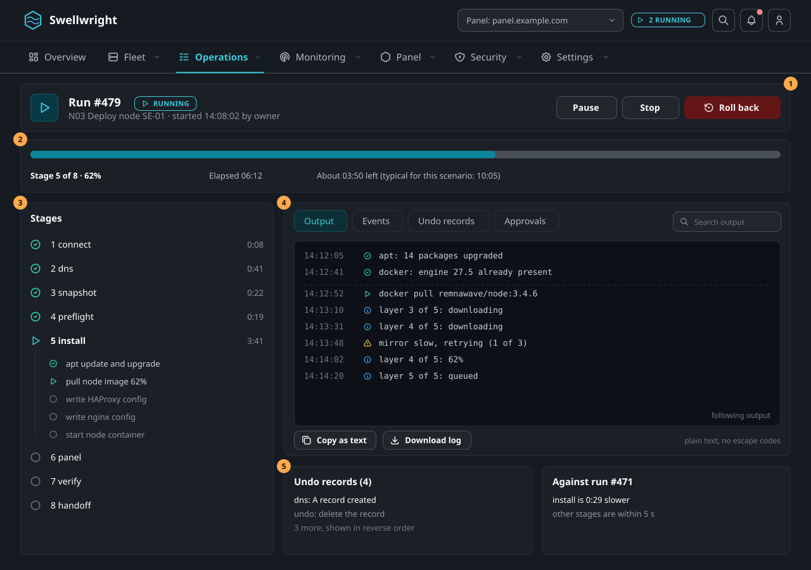
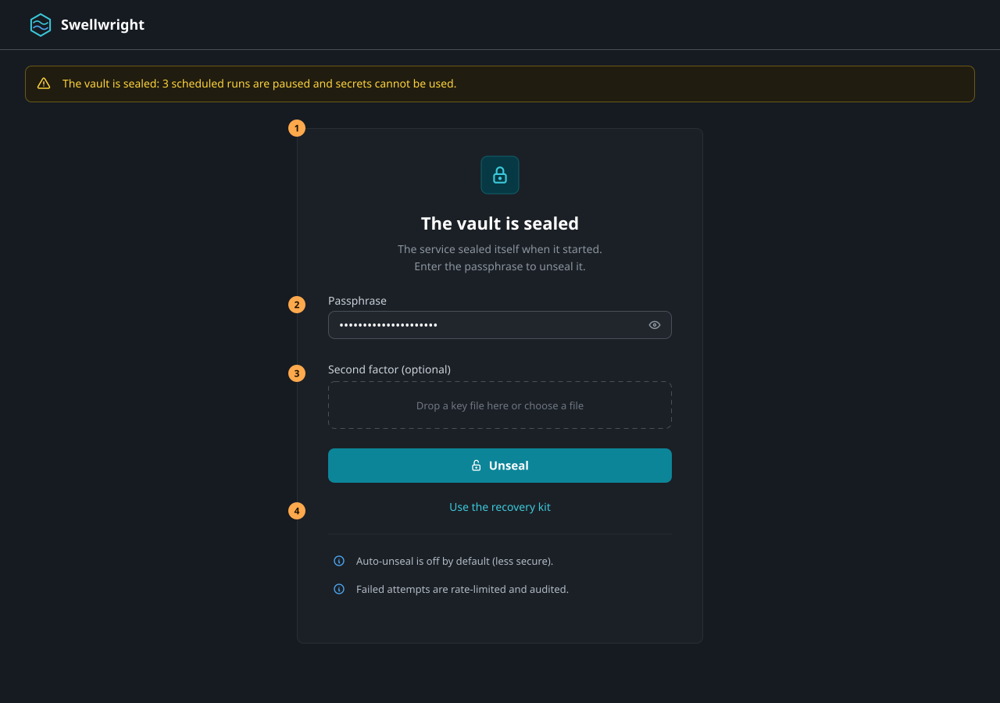
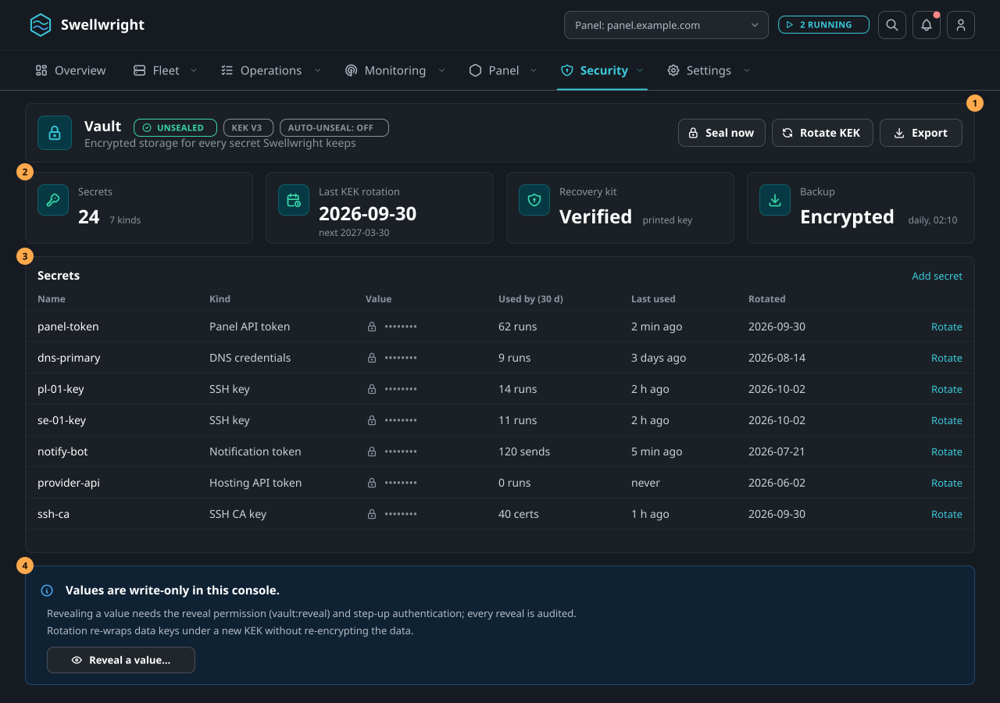
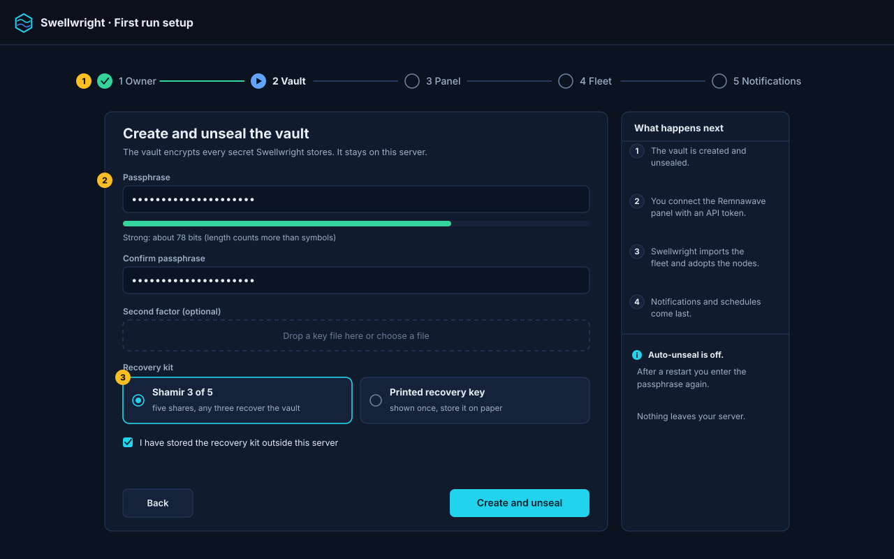
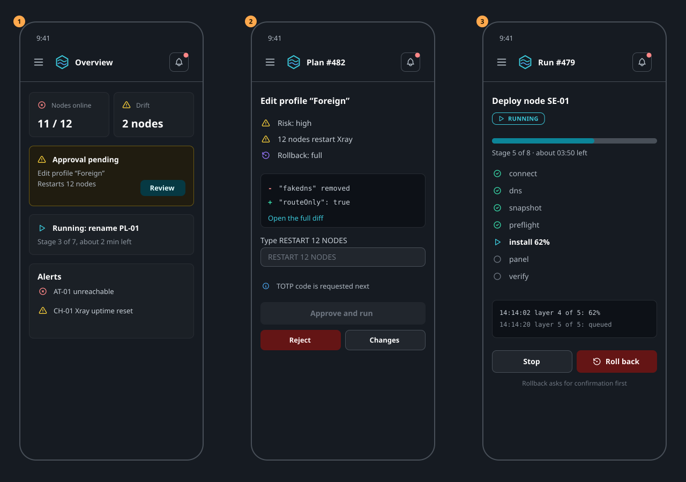

# UI wireframes

Annotated wireframes for the screens that carry the most design risk. They complement [07. UI and UX](../07-ui-ux.md) and use the same vocabulary: plan drawer, live run, approvals, sealed vault, wizard.

## How to read them

- They are layout and behavior sketches, not pixel specifications. Colors, fonts, icons, radii and component variants are taken from the Remnawave panel frontend 3.4.11 (see [Visual language](#visual-language) and [ADR 0011](../../../adr/0011-ui-built-on-the-panel-code-and-theme.md)); the real UI is built from the same Mantine components. Text is set in Montserrat and Fira Mono, so a viewer without these fonts sees a system font and slightly different widths.
- All data is fictional: `example.com`, documentation IP ranges, invented node names and run numbers.
- Status is never conveyed by color alone: every status has an icon and a word. Icons: check = done or healthy, cross = error or blocked, exclamation = warning or drift, play = running, ring = waiting, curved arrow = rollback, "i" = information. No emoji are used in the UI.
- Yellow numbered markers match the notes under each screen.
- Every change in the wireframes starts with a plan (dry run) and ends with a verification, as the engine requires ([08](../08-engine.md)).

## Visual language

Swellwright must look like the panel it manages, so every visual decision below is read from the panel frontend (version 3.4.11, `src/shared/constants/theme` and `src/app/layouts`), not invented.

| Aspect | Value in the panel | Where it is defined |
|---|---|---|
| Library | Mantine 9.5, React 19 | `package.json` |
| Color scheme | dark; body `#161b22`, text `#c9d1d9`, dimmed text `#8b949e`, input and default button `#21262d`, default border `#484f58`; the palette is GitHub-like (`dark` 0 to 9: `#c9d1d9` to `#010409`) | `theme.ts` |
| Primary color | cyan, shade 8 (`#0c8599`) for filled buttons; `#3bc9db` (cyan 4) for active text and links; tinted fills from cyan 6 | `theme.ts`, `colors-resolver.tsx` |
| Status colors | teal = success or online, red = error or offline, yellow or orange = warning, violet = rollback, blue = information, gray = neutral | usage across the panel |
| Fonts | Montserrat for text (weights 400 to 600), Fira Mono for code and terminals; Vazirmatn and Noto Sans SC as fallbacks | `theme.ts`, `index.html` |
| Radius | `md` (8 px) on buttons, inputs, cards, badges, tabs; `lg` (16 px) on the optional sidebar | `theme.ts`, `overrides` |
| Cards | translucent white: 2% fill and 8% border over the body | `overrides/card` |
| Buttons | the default variant is "light" (tinted cyan); the main action is "filled"; danger is a tinted red | `overrides/buttons.tsx` |
| Badges | outline variant, uppercase, `md` radius | `overrides/badge.ts` |
| Tabs | pill tabs with a thin border; the active tab is tinted cyan | `overrides/tabs` |
| Theme icon | the custom "soft" variant: tinted gradient with a thin tinted border | `colors-resolver.tsx` |
| Drawer and modal | translucent header, overlay 60% black | `overrides/drawer`, `overrides/modal` |
| Layout | compact by default: a fixed header of 116 px (64 px brand row, 52 px navigation row; 64 px with the tabs in the brand row from 2048 px, where pages get 10vw side padding), 32 px page padding, a header card at the top of every page; below 64em a 64 px header with a burger and a floating 300 px drawer; the floating sidebar is the panel's "legacy" option and is not built | `layout-variants`, `navbar` |
| Header controls | 44 px squares, radius 16 px, a dark gradient, a cyan sheen on hover; Version (a pill, glows when a release is newer), GitHub (a pill with the gold star and the count), language, sign out | `shared/ui/header-buttons` |
| Icons | Tabler Icons, outline | dependencies |

Things to do in `packages/ui` before building screens: mirror these values as tokens, self-host the two fonts instead of loading them from a CDN (no visitor address leaks, works offline), and re-check the table on every supported panel minor version.

The panel 3.4.11 also ships a browser SSH terminal with its own client-side vault (saved connections, snippets, host-key confirmation). Its screens are a ready reference for the Swellwright terminal and vault patterns ([risks](../12-risks-open.md)).

## 1. Overview

1. **KPI cards:** fleet state at a glance. Each card opens the matching filtered list (offline nodes, drift, active runs, alerts).
2. **Fleet health:** state, users online, Xray version, drift and certificate expiry per node. Filters and saved views live on the Servers page.
3. **Needs your attention:** pending approvals first, then active runs and notices (new releases, vulnerabilities). Approvals are never hidden behind a menu.
4. **Availability matrix:** node by carrier by time slot, filled by probe agents. A cell shows an icon, not only a color.

The header follows the panel's compact layout: a brand row with the panel switcher, the tray of active runs, search and commands (Ctrl+K) and the alerts, and a navigation row with grouped sections ([07](../07-ui-ux.md#2-shell)).

## 2. Server card

1. **Header actions:** "Run check" is read-only. "Open terminal" needs the `terminal:use` permission and step-up authentication, and the user types real SSH data for every session. "Scenarios" lists every workflow that applies to this server; each starts with a dry run.
2. **Facts** are collected over SSH without changing anything and refreshed on a schedule.
3. **Access:** the access method, the pinned host key (a changed key blocks operations and raises an alert) and the node API port rule.
4. **Baseline and drift:** the result of the baseline check set. "Plan repair" produces a dry run; looking at drift never changes anything.
5. **Linked panel node and run history.** Every run links to its card.

## 3. Plan and approval

1. **Summary tiles:** risk, impact and rollback from the impact calculator. Editing a shared config profile restarts every node of that profile, so the plan says so.
2. **Diff:** exactly what will be sent to the panel (unified by default, side by side on demand).
3. **Policy checks:** which policies were evaluated. A warning means an exception the approver has to acknowledge.
4. **Approval** is bound to the plan hash, so a changed plan cannot be approved by accident. High-risk plans also need a confirmation phrase and step-up authentication; "Approve and run" stays disabled until both are done. A second approver is an optional policy.

## 4. Run card

1. **Controls:** Pause, Stop and Roll back. Rolling back asks for confirmation and is itself a run built from the undo records.
2. **Progress:** stage N of M, percentage, elapsed time and a remaining-time estimate taken from earlier runs of the same scenario.
3. **Stages and steps** with statuses. Waiting steps (for example DNS propagation) are shown as steps, not hidden.
4. **Output:** streamed from the node-side step log, so a dropped SSH session does not stop it. Search, "Copy as text" (plain text without escape codes) and "Download log" are always available.
5. **Undo records and comparison** with the previous run by stage timing.

## 5. Sealed vault

1. **State banner:** says what is paused while the vault is sealed (scheduled runs, any use of secrets).
2. **Passphrase** unseals the vault. Failed attempts are rate-limited and audited.
3. **Second factor (optional):** a key file kept on another machine.
4. **Recovery kit** path for a lost passphrase. Auto-unseal is off by default ([ADR 0006](../../../adr/0006-secrets-vault-with-envelope-encryption.md)).

## 6. Vault

1. **Actions:** "Seal now", "Rotate KEK" and "Export" need step-up authentication.
2. **Status cards:** secret count, last and next KEK rotation, recovery kit verification, backup state.
3. **Secrets** are listed with kind, use and rotation dates. Values are write-only in the console.
4. **Reveal** needs the `vault:reveal` permission and step-up authentication, and every reveal is written to the audit log.

## 7. First-run setup

1. **Stepper:** owner, vault, panel connection, fleet import, notifications and schedules ([09](../09-ops-docker.md#6-first-run)). Steps are completed in order; a finished step can be revisited.
2. **Passphrase** with a strength meter that favors length over symbol rules.
3. **Recovery kit:** Shamir 3 of 5 or a printed recovery key, and an explicit confirmation that it is stored outside the server.

## 8. Phone

The emergency use case is "look and roll back": the overview, an approval and a run are usable on a phone. Approval keeps the confirmation phrase and step-up, so a phone is not a weaker path. Wide tables, the terminal and editors are desktop-first.

1. **Overview** with the pending approval on top.
2. **Approval** with a compact diff and the same confirmation.
3. **Run** with Stop and Roll back within reach; rolling back asks for confirmation first.

## Screens not drawn yet

These are drawn when the phase that builds them starts ([roadmap](../11-roadmap.md)): scenario catalog and parameter forms, profile editor (Monaco, inbound builder, impact calculator), hosts with convention violations, hop-chain topology and wizard, DNS, certificates, probes matrix page, schedules, reports, audit, API console, terminal, plugins and settings.

| Phase | Screens |
|---|---|
| 1. Skeleton and plugin runtime | shell, sealed vault, vault, first-run setup, plugins |
| 2. Inventory and SSH core | servers, server card, terminal |
| 3. Panel integration | panel browsers, profile editor, impact calculator, API console |
| 4. Engine and first workflows | scenario catalog, plan drawer, run card, approvals |
| 5 to 7 | DNS, certificates, chains, templates, schedules |
| 8. Probes and monitoring | availability matrix page, alerts |
