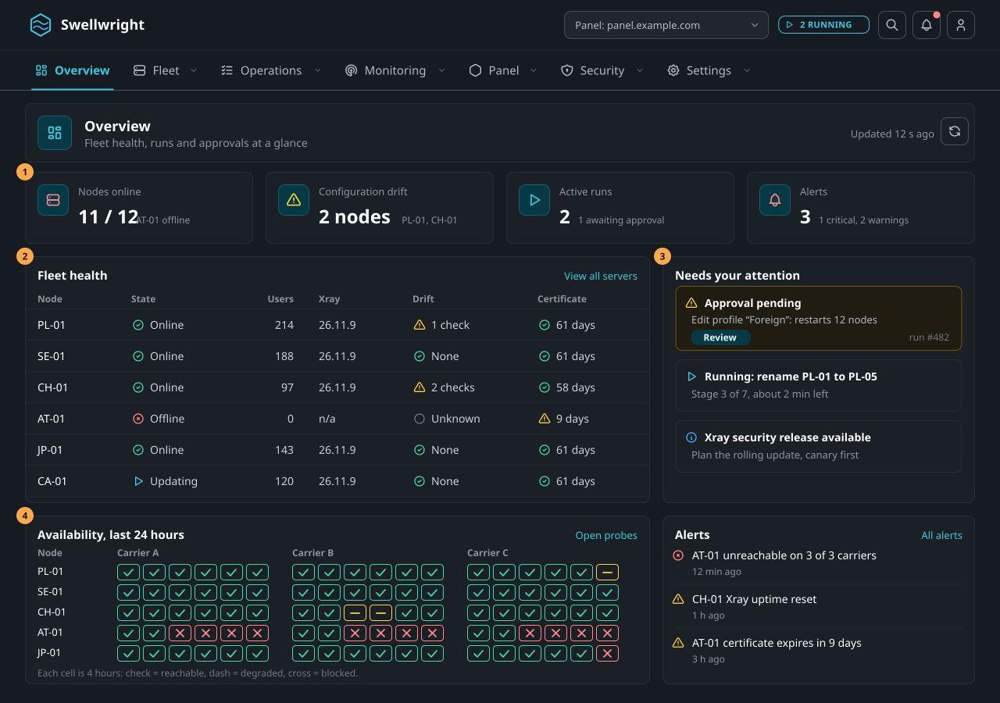
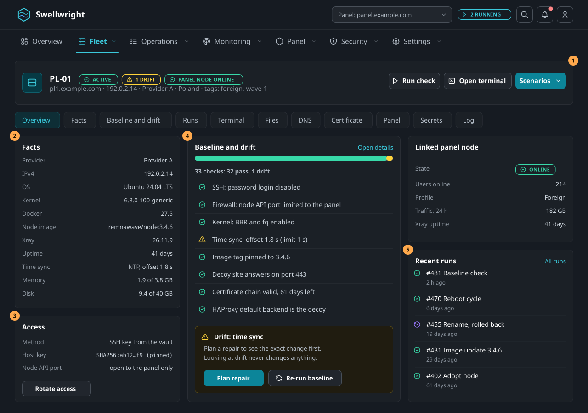
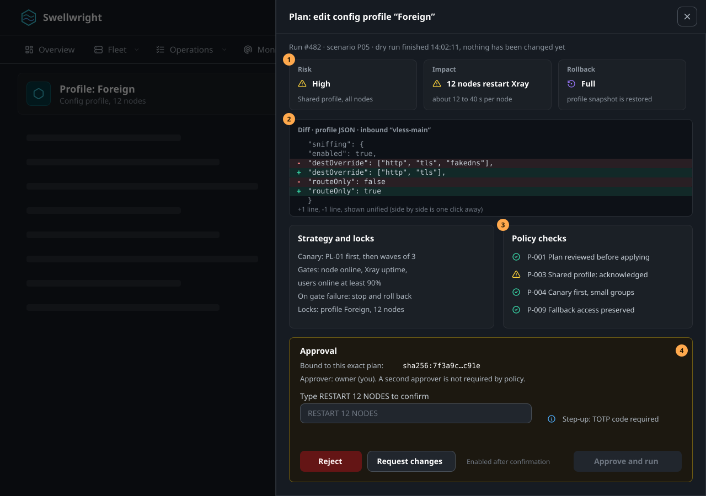
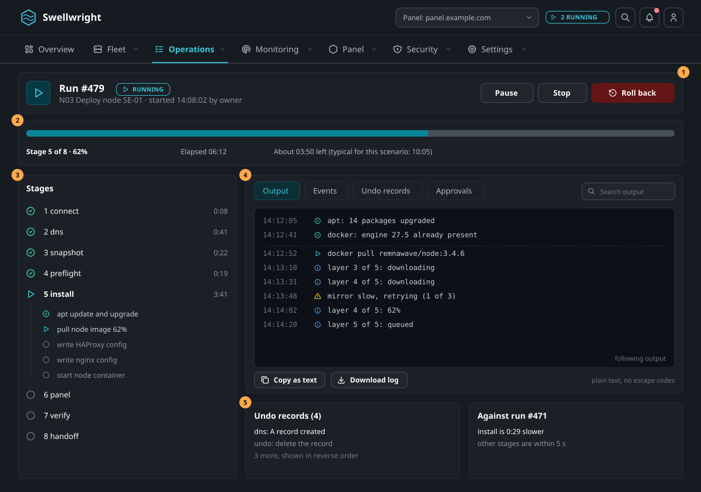
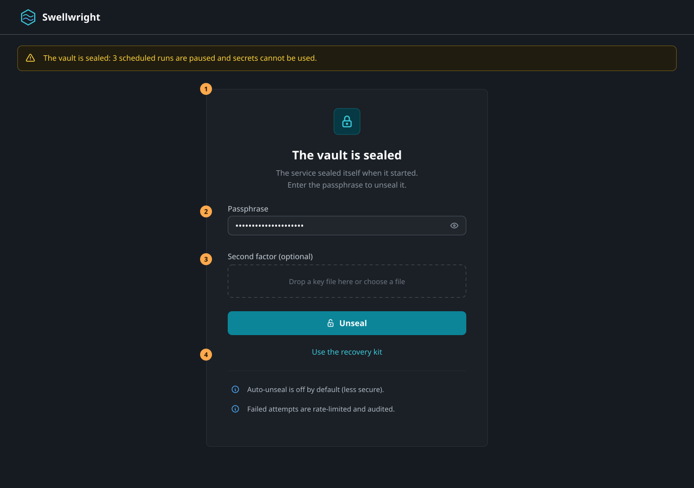
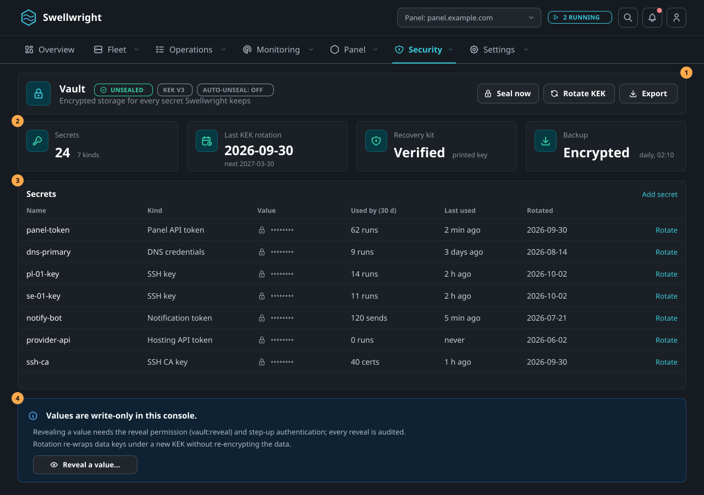
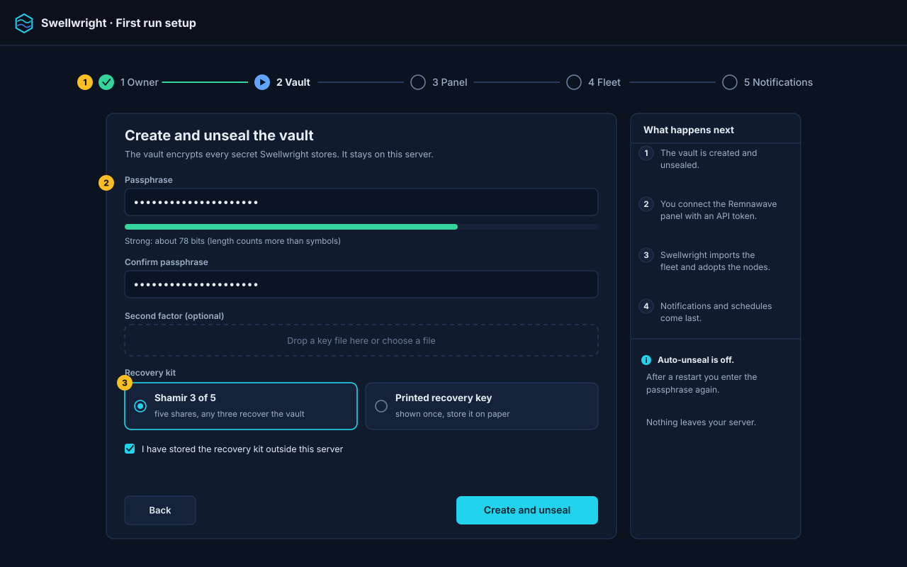
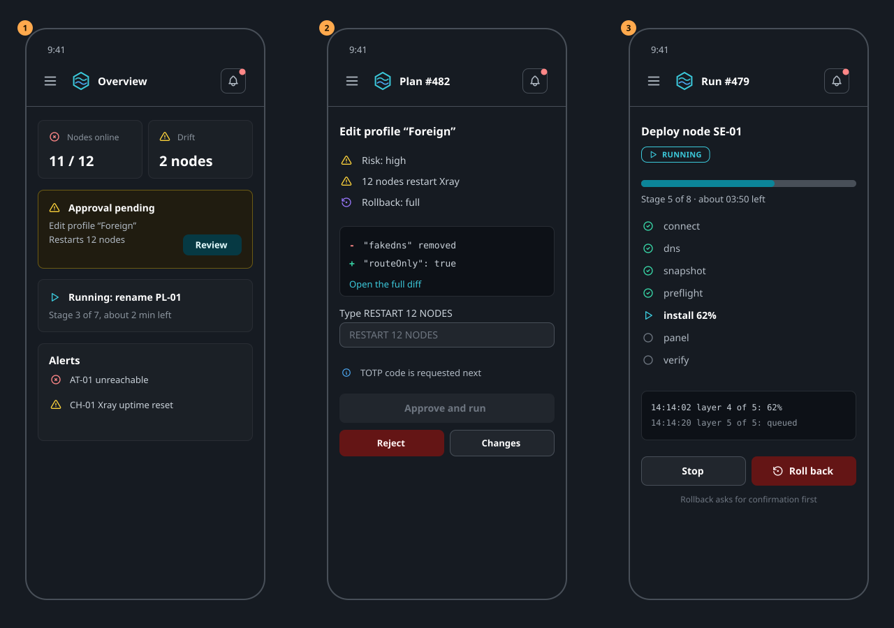

# Макеты интерфейса

Аннотированные макеты экранов, где риск проектирования выше всего. Они дополняют [07. Интерфейс и UX](../07-ui-ux.md) и используют те же понятия: панель плана, живой запуск, согласования, запечатанное хранилище, мастер. Картинки общие для обоих языков (подписи на экранах английские, как и сам интерфейс по умолчанию), лежат в [`docs/en/design/wireframes/`](../../../en/design/wireframes/README.md).

## Как читать

- Это наброски раскладки и поведения, а не пиксельные спецификации. Цвета, шрифты, иконки, радиусы и варианты компонентов взяты из фронтенда панели Remnawave 3.4.11 (см. [Визуальный язык](#визуальный-язык) и [ADR 0011](../../../adr/0011-ui-built-on-the-panel-code-and-theme.md)); настоящий интерфейс строится из тех же компонентов Mantine. Текст набран Montserrat и Fira Mono, поэтому без этих шрифтов зритель увидит системный шрифт и чуть другую ширину.
- Все данные вымышленные: `example.com`, диапазоны адресов для документации, придуманные имена нод и номера запусков.
- Статус никогда не передаётся только цветом: у каждого статуса есть значок и слово. Значки: галочка = выполнено или здорово, крест = ошибка или блок, восклицательный знак = предупреждение или дрейф, треугольник = выполняется, кольцо = ожидание, изогнутая стрелка = откат, «i» = информация. Эмодзи в интерфейсе нет.
- Жёлтые номера на картинках соответствуют примечаниям под каждым экраном.
- Любое изменение в макетах начинается с плана (сухой прогон) и заканчивается проверкой, как требует движок ([08](../08-engine.md)).

## Визуальный язык

Swellwright должен выглядеть как панель, которой он управляет, поэтому каждое решение ниже прочитано из фронтенда панели (версия 3.4.11, `src/shared/constants/theme` и `src/app/layouts`), а не придумано.

| Аспект | Значение в панели | Где задано |
|---|---|---|
| Библиотека | Mantine 9.5, React 19 | `package.json` |
| Цветовая схема | тёмная; фон `#161b22`, текст `#c9d1d9`, приглушённый текст `#8b949e`, поле ввода и кнопка по умолчанию `#21262d`, граница по умолчанию `#484f58`; палитра в духе GitHub (`dark` 0-9: от `#c9d1d9` до `#010409`) | `theme.ts` |
| Основной цвет | cyan, оттенок 8 (`#0c8599`) для залитых кнопок; `#3bc9db` (cyan 4) для активного текста и ссылок; тонированные заливки от cyan 6 | `theme.ts`, `colors-resolver.tsx` |
| Цвета статусов | teal = успех или в сети, red = ошибка или не в сети, yellow или orange = предупреждение, violet = откат, blue = информация, gray = нейтрально | использование в панели |
| Шрифты | Montserrat для текста (насыщенность 400-600), Fira Mono для кода и терминалов; запасные Vazirmatn и Noto Sans SC | `theme.ts`, `index.html` |
| Радиус | `md` (8 px) у кнопок, полей, карточек, бейджей, вкладок; `lg` (16 px) у необязательного бокового меню | `theme.ts`, `overrides` |
| Карточки | полупрозрачный белый: заливка 2% и граница 8% поверх фона | `overrides/card` |
| Кнопки | вариант по умолчанию «light» (тонированный cyan); главное действие «filled»; опасное действие красное тонированное | `overrides/buttons.tsx` |
| Бейджи | вариант с контуром, заглавные буквы, радиус `md` | `overrides/badge.ts` |
| Вкладки | вкладки-таблетки с тонкой границей; активная тонирована cyan | `overrides/tabs` |
| Значок в рамке | собственный вариант «soft»: тонированный градиент с тонкой границей | `colors-resolver.tsx` |
| Панель и модальное окно | полупрозрачная шапка, затемнение 60% | `overrides/drawer`, `overrides/modal` |
| Макет | по умолчанию компактный: закреплённая шапка 116 px (строка бренда 64 px, строка навигации 52 px; 64 px с вкладками в строке бренда от 2048 px, где у страниц отступы по 10vw), отступ страницы 32 px, карточка-шапка наверху каждой страницы; ниже 64em шапка 64 px с бургером и плавающим выдвижным блоком 300 px; плавающее боковое меню это «устаревший» вариант панели и не строится | `layout-variants`, `navbar` |
| Кнопки шапки | квадраты 44 px, скругление 16 px, тёмный градиент, голубой отблеск при наведении; версия (плашка, светится, когда вышел новый релиз), GitHub (плашка с золотой звездой и числом), язык, выход | `shared/ui/header-buttons` |
| Иконки | Tabler Icons, контурные | зависимости |

Что сделать в `packages/ui` до экранов: перенести эти значения в токены, разместить оба шрифта у себя вместо загрузки с CDN (адреса посетителей не утекают, работает без интернета) и перепроверять таблицу на каждой поддерживаемой минорной версии панели.

В панели 3.4.11 есть и браузерный SSH-терминал со своим клиентским хранилищем (сохранённые подключения, сниппеты, подтверждение ключа хоста). Его экраны хороший образец для терминала и хранилища Swellwright ([риски](../12-risks-open.md)).

## 1. Обзор

1. **Карточки показателей:** состояние парка с одного взгляда. Каждая открывает соответствующий отфильтрованный список (ноды не в сети, дрейф, активные запуски, тревоги).
2. **Здоровье парка:** состояние, пользователи онлайн, версия Xray, дрейф и срок сертификата по каждой ноде. Фильтры и сохранённые виды на странице «Серверы».
3. **Требует внимания:** сначала ожидающие согласования, затем активные запуски и уведомления (новые релизы, уязвимости). Согласования не прячутся в меню.
4. **Матрица доступности:** нода по оператору по времени суток, заполняется агентами-зондами. В ячейке значок, а не только цвет.

Шапка повторяет компактный макет панели: строка бренда с переключателем панелей, лотком активных запусков, поиском и командами (Ctrl+K) и тревогами, и строка навигации со сгруппированными разделами ([07](../07-ui-ux.md#2-каркас)).

## 2. Карточка сервера

1. **Действия в шапке:** «Run check» только читает. «Open terminal» требует права `terminal:use` и повышенной аутентификации, а реальные данные SSH пользователь вводит на каждую сессию. «Scenarios» показывает все рабочие процессы, применимые к серверу; каждый начинается с сухого прогона.
2. **Факты** собираются по SSH без изменений и обновляются по расписанию.
3. **Доступ:** способ доступа, закреплённый ключ хоста (смена ключа блокирует операции и поднимает тревогу) и правило порта API ноды.
4. **Эталон и дрейф:** результат набора проверок эталона. «Plan repair» делает сухой прогон; просмотр дрейфа ничего не меняет.
5. **Связанная нода панели и история запусков.** Каждый запуск ведёт на свою карточку.

## 3. План и согласование

1. **Плитки сводки:** риск, влияние и откат из калькулятора влияния. Правка общего профиля перезапускает все его ноды, и план говорит об этом прямо.
2. **Diff:** ровно то, что уйдёт в панель (единый по умолчанию, рядом по запросу).
3. **Проверки политик:** какие политики оценивались. Предупреждение означает исключение, которое согласующий должен принять осознанно.
4. **Согласование** привязано к хешу плана, поэтому изменённый план нельзя одобрить случайно. Для высокого риска нужны ещё фраза подтверждения и повышенная аутентификация; «Approve and run» неактивна, пока они не выполнены. Второй согласующий включается политикой.

## 4. Карточка запуска

1. **Управление:** Pause, Stop и Roll back. Откат просит подтверждение и сам является запуском, собранным из записей отката.
2. **Прогресс:** этап N из M, процент, прошедшее время и оценка остатка по прошлым запускам того же сценария.
3. **Этапы и шаги** со статусами. Шаги ожидания (например, распространение DNS) показаны как шаги, а не скрыты.
4. **Вывод:** транслируется из журнала шага на ноде, поэтому обрыв SSH его не останавливает. Поиск, «Copy as text» (обычный текст без управляющих кодов) и «Download log» всегда под рукой.
5. **Записи отката и сравнение** с предыдущим запуском по времени этапов.

## 5. Запечатанное хранилище

1. **Баннер состояния:** что приостановлено, пока хранилище запечатано (плановые запуски, любое использование секретов).
2. **Парольная фраза** распечатывает хранилище. Неудачные попытки ограничиваются по частоте и попадают в аудит.
3. **Второй фактор (необязательно):** файл ключа, хранящийся на другой машине.
4. **Набор восстановления** на случай потери фразы. Автораспечатывание по умолчанию выключено ([ADR 0006](../../../adr/0006-secrets-vault-with-envelope-encryption.md)).

## 6. Хранилище

1. **Действия:** «Seal now», «Rotate KEK» и «Export» требуют повышенной аутентификации.
2. **Карточки состояния:** число секретов, последняя и следующая ротация KEK, проверка набора восстановления, состояние резервных копий.
3. **Секреты** с видом, использованием и датами ротации. Значения в консоли только для записи.
4. **Показ значения** требует права `vault:reveal` и повышенной аутентификации, каждый показ пишется в журнал аудита.

## 7. Первый запуск

1. **Шаги:** владелец, хранилище, подключение панели, импорт парка, уведомления и расписания ([09](../09-ops-docker.md#6-первый-запуск)). Шаги проходятся по порядку, завершённый можно открыть снова.
2. **Парольная фраза** с индикатором стойкости, который ценит длину выше правил про символы.
3. **Набор восстановления:** Шамир 3 из 5 или печатный ключ восстановления и явное подтверждение, что он хранится вне сервера.

## 8. Телефон

Аварийный сценарий «посмотреть и откатить»: обзор, согласование и запуск удобны на телефоне. Согласование сохраняет фразу подтверждения и повышенную аутентификацию, так что телефон не слабее по защите. Широкие таблицы, терминал и редакторы рассчитаны в первую очередь на компьютер.

1. **Обзор** с ожидающим согласованием сверху.
2. **Согласование** с компактным diff и тем же подтверждением.
3. **Запуск** с Stop и Roll back под рукой; откат сначала просит подтверждение.

## Экраны, которые ещё не нарисованы

Они рисуются, когда начинается фаза, которая их строит ([дорожная карта](../11-roadmap.md)): каталог сценариев и формы параметров, редактор профиля (Monaco, конструктор инбаундов, калькулятор влияния), хосты с нарушениями конвенций, топология и мастер цепочек хопов, DNS, сертификаты, страница матрицы зондов, расписания, отчёты, аудит, консоль API, терминал, плагины и настройки.

| Фаза | Экраны |
|---|---|
| 1. Каркас и среда плагинов | оболочка, запечатанное хранилище, хранилище, первый запуск, плагины |
| 2. Инвентарь и SSH-ядро | серверы, карточка сервера, терминал |
| 3. Интеграция с панелью | обозреватели панели, редактор профиля, калькулятор влияния, консоль API |
| 4. Движок и первые сценарии | каталог сценариев, панель плана, карточка запуска, согласования |
| 5-7 | DNS, сертификаты, цепочки, шаблоны, расписания |
| 8. Зонды и мониторинг | страница матрицы доступности, тревоги |
